

  

<h1 align="center">Colorful Control Center</h1>

An unofficial Windows control center for Colorful gaming laptops

<a href="README.md">简体中文</a> · English

  <a href="https://github.com/y4Nkk/colorful-control-center/releases">Download</a> · <a href="CHANGELOG.md#200">2.0.0 release notes</a> · <a href="docs/development.md">Build from source</a>

## About the project

Colorful Control Center is an open-source Windows x64 hardware control console for Colorful gaming laptops. Monitor your CPU, GPU, fans, and memory, and adjust the performance, cooling, keyboard lighting, charging, and display settings available on your device.

Built-in profiles cover quiet office work, battery life, and plugged-in gaming. Compare current and target values before applying a profile. Save your own settings as personal profiles for startup, AC power, battery power, and wake events. Preferences and profiles are stored locally.

## Download and install

1. Choose a release and download its Windows x64 installer. The 2.0.0 installer is named `ColorfulControlCenter_2.0.0_x64-setup.exe`. Verify the download with `SHA256SUMS.txt` from the same release. [Downloads](https://github.com/y4Nkk/colorful-control-center/releases)
2. Run the installer for your current Windows account. It requires .NET Framework 4.8.1 and can prepare WebView2 online when needed. [System requirements](https://learn.microsoft.com/dotnet/framework/get-started/system-requirements)
3. Open Overview to see the hardware readings available on your device. Versions with in-app updates can check for updates at the bottom of the sidebar or under Settings → About.

## Device support

The project targets Colorful laptops based on Clevo or LCFC chassis. The reference device is the Colorful 将星 X15 AT 23 with a Core i5-13500HX and GeForce RTX 4060 Laptop GPU. Presets, fan curves, charge limits, and graphics switching depend on the model, firmware, and drivers. OEM controls use the matching InsydeDCHU components and drivers. Some live CPU tuning also requires PawnIO. [Hardware acceptance checklist](docs/acceptance-checklist.md)

Manage OEM process handling under Settings → Runtime and Diagnostics. By default, the app closes recognized OEM Control Center, Flexikey, and FnKey processes at startup and while running to prevent competing writes to the same hardware settings.

## Features

| Workspace | Main features |
| --- | --- |
| **Overview** | Current preset, CPU and GPU temperatures and utilization, memory trends, and disk usage. Open details for additional GPU and memory readings. |
| **Performance and cooling** | Switch supported presets, monitor fan speeds, and tune fan modes, speed offsets, curves, CPU power and voltage, and GPU frequencies. |
| **Keyboard and lighting** | Adjust zone or per-key RGB, peripheral lighting, and idle shutoff. Manage key mappings, macros, and authorized OEM hotkeys and on-screen displays. |
| **Power and profiles** | Manage Windows power plans, charging limits, energy schedules, power delivery, and USB selective suspend. Create, import, and export profiles, compare current and target values, and set automation rules. |
| **Device configuration** | Manage refresh rate, primary display orientation, graphics mode, discrete GPU power, touchpad, microphone, and airplane mode. Refresh-rate and primary-display rotation changes have a 15-second trial. |
| **Settings and tray** | Manage theme, fonts, scaling, motion, window behavior, and launch at sign-in. Use the tray to change supported presets, control fans, or open a profile. |

## Screenshots

These screenshots show the Simplified Chinese interface from the 2.0.0 production build. Hardware readings, device states, and profiles use simulated data. [Capture notes](docs/screenshots/README.md#capture-notes)

### Overview

See the current preset and compare CPU and GPU temperature, frequency, fan output, and utilization side by side.

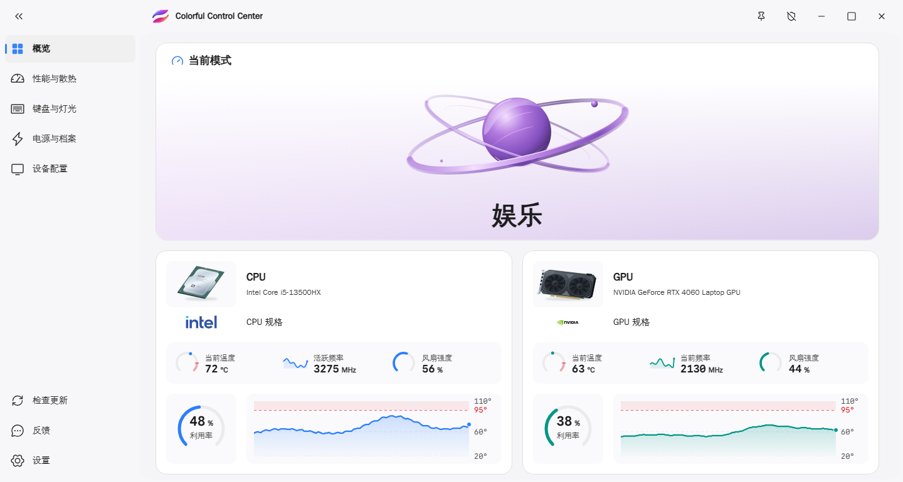

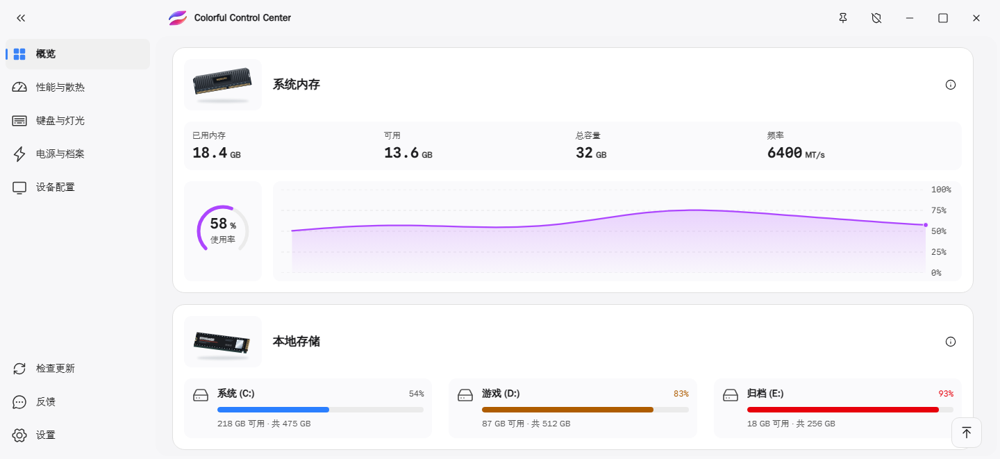

### Performance and cooling

Presets, CPU power and voltage, and GPU frequency share one workspace.

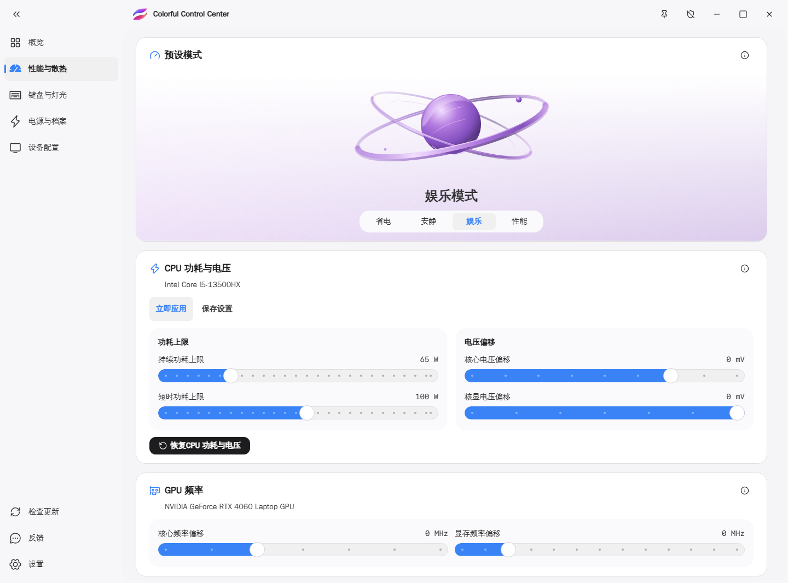

All fan modes show live speed gauges by default. Open the curve editor beside Restore Settings from any mode. Select Apply to save the points locally. Selecting Custom writes the saved curves to the firmware.

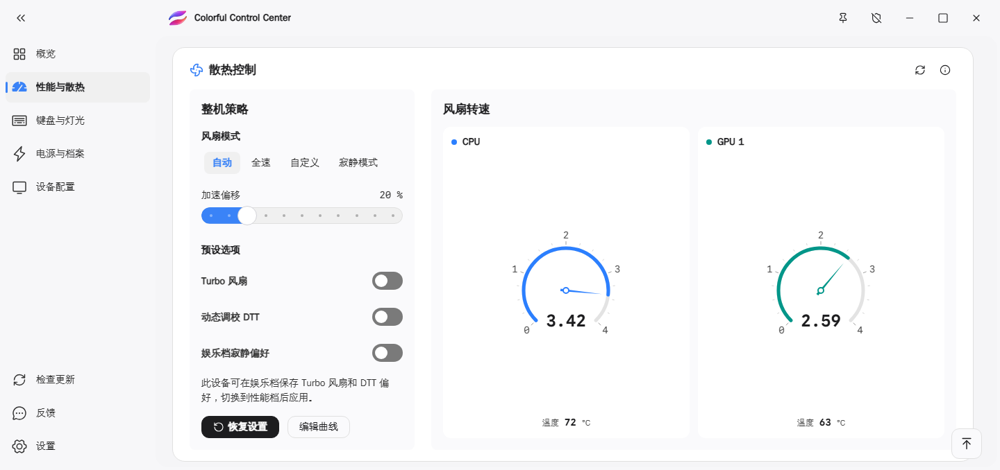

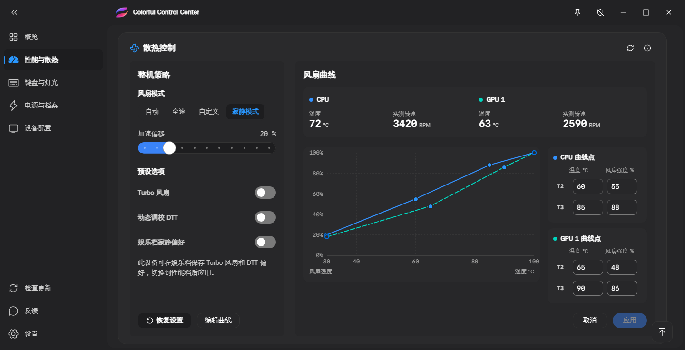

### Keyboard and lighting

The keyboard preview follows each lighting zone’s color, power, and brightness.

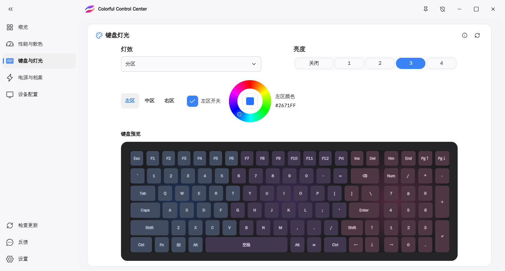

### Power and profiles

Power settings show the active Windows power plan and battery and charging status. Profile previews show current settings and targets side by side.

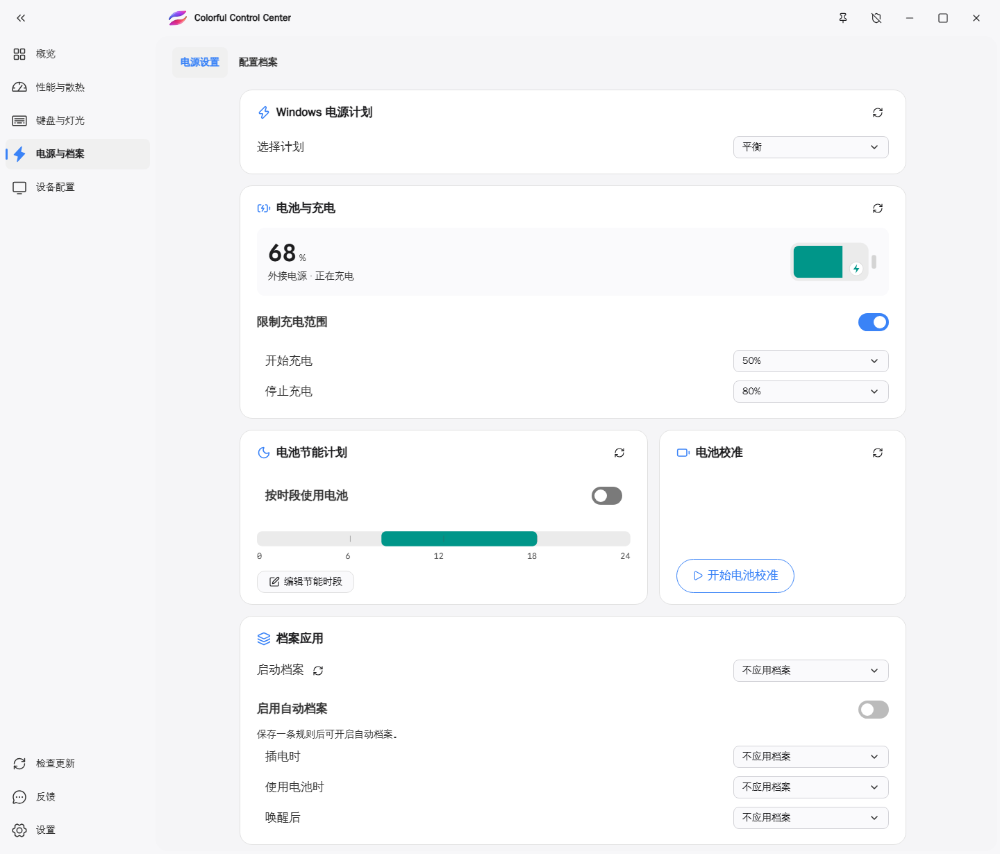

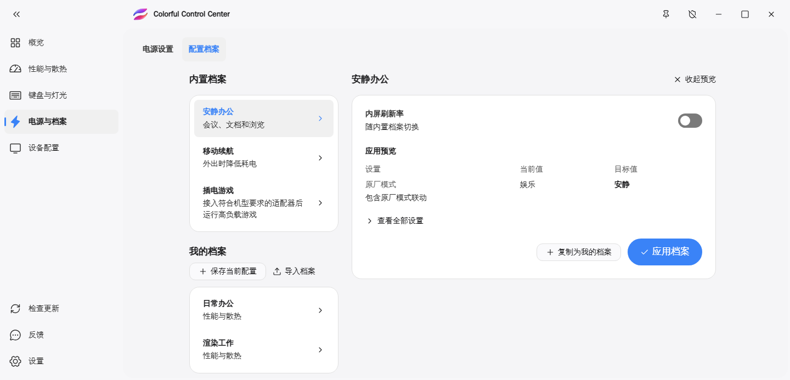

### Device configuration

Manage the display, automatic refresh rate, graphics mode, and discrete GPU power from one workspace.

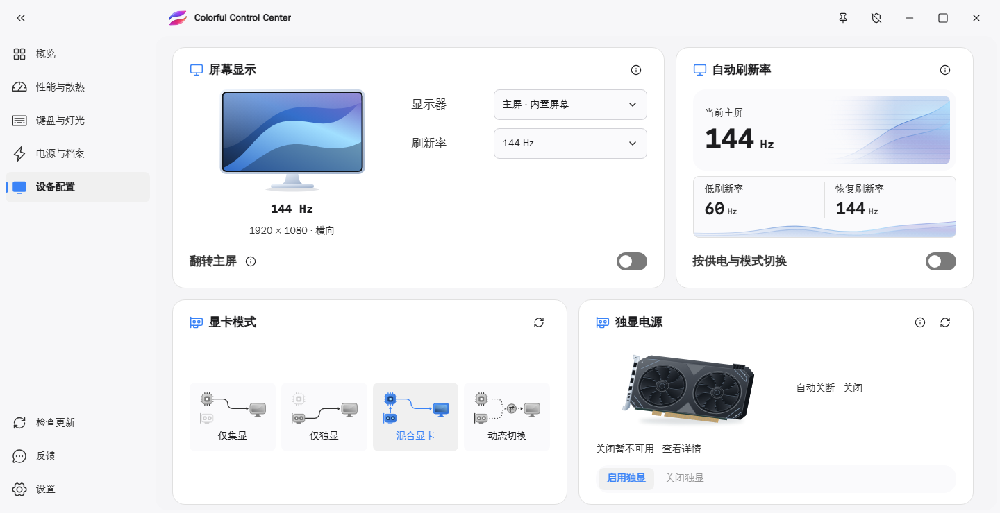

### Settings

Settings are grouped in a single column for appearance, fonts, scaling, and window behavior.

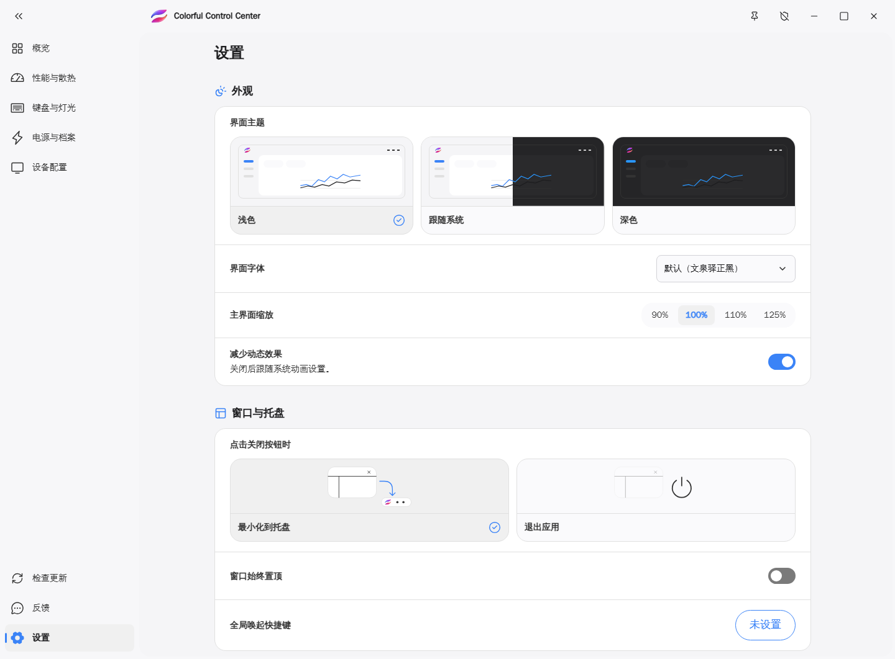

### Windows setup

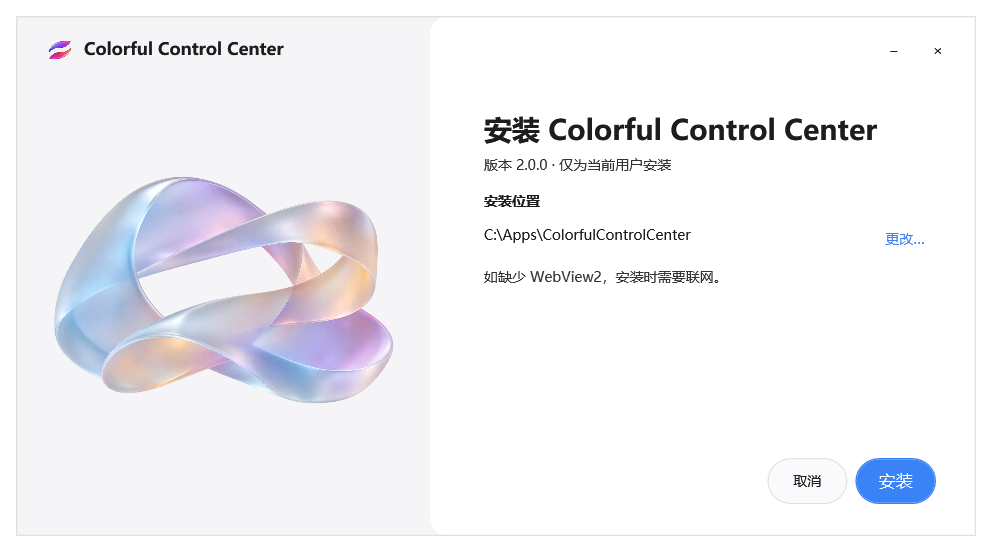

## Documentation

- [Development, builds, and isolated verification](docs/development.md)
- [Hardware architecture and recovery](docs/design.md)
- [Interface design and component contracts](DESIGN.md)
- [Version history](CHANGELOG.md)
- [Report a problem or suggest a feature](https://github.com/y4Nkk/colorful-control-center/issues/new/choose)

## License

GPL-3.0. [LICENSE](LICENSE)
