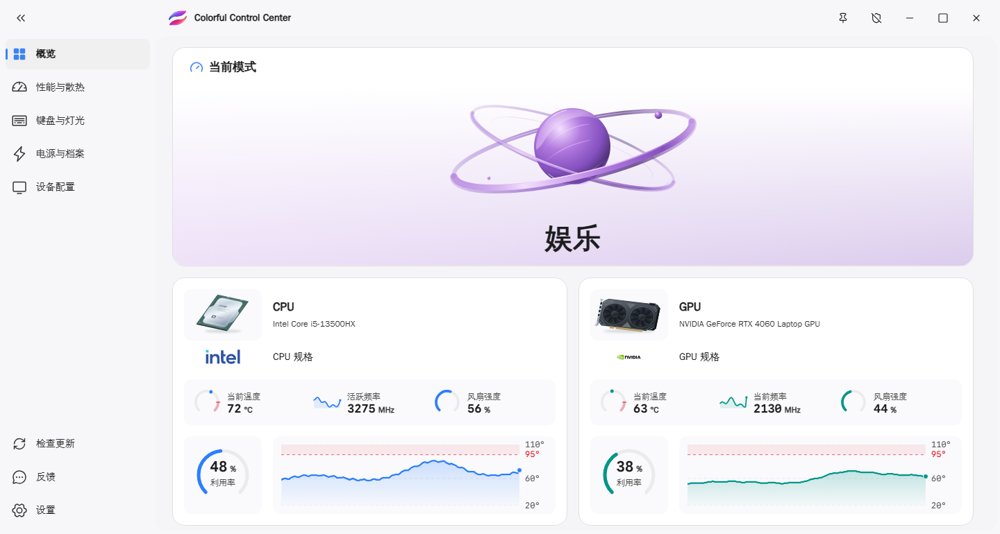
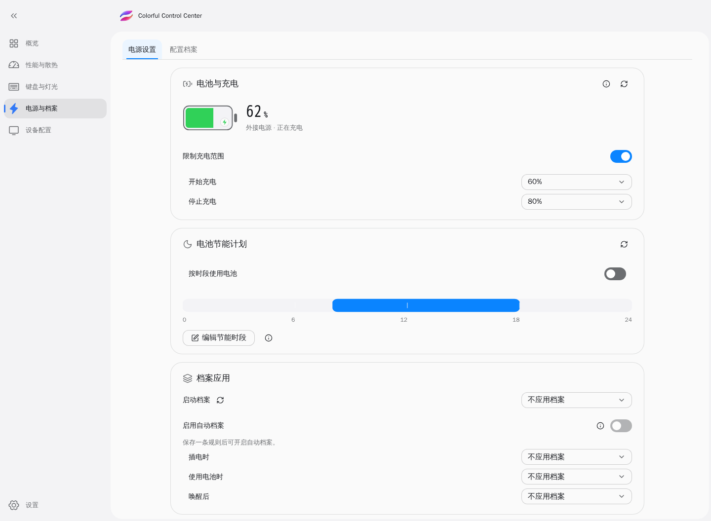

  

<h1 align="center">Colorful Control Center</h1>

七彩虹游戏本的非官方 Windows 控制台

  <a href="CHANGELOG.md">更新日志</a> · <a href="docs/development.md">源码构建</a> · <a href="https://github.com/y4Nkk/colorful-control-center/releases">GitHub Releases</a>

在一个窗口里查看温度和风扇转速，调整性能、键盘灯光与充电策略，并把常用配置保存为档案。项目以七彩虹将星 X15 AT 23（Core i5-13500HX、GeForce RTX 4060 Laptop）为开发基准。可用设置随蓝天或联宝机型、固件和驱动能力变化。

## 界面预览

下图使用 1.0.0 前端，在断网 Docker 容器内由 Chromium 渲染。传感器读数和设备状态均为模拟数据。

| 风扇散热 | 键盘与灯光 |
| --- | --- |
|  |  |

## 功能

| 工作区 | 可以做什么 |
| --- | --- |
| **系统** | 查看温度、转速和容量。切换原厂预设，调整原厂风扇模式、偏移和曲线，调节 CPU 功耗、电压及 GPU 核心与显存偏移。按组保存、预览、导入和导出配置档案。 |
| **键盘与灯光** | 按设备能力设置分区或逐键 RGB、外围灯区和闲置关灯。管理按键映射、宏，以及授权接管的原厂热键与屏显。 |
| **电源** | 查看电池状态和健康度，管理充电保护、节能、供电及 USB 选择性暂停，按启动、插电、电池或唤醒条件应用档案。 |
| **设备配置** | 设置刷新率、主屏方向和显卡模式，管理独显电源、触摸板、麦克风及飞行模式。显卡切换可在重启后核对结果。 |
| **设置与托盘** | 调整主题、字体、缩放、窗口和启动偏好，选择普通或管理员登录自启。通过托盘切换受支持的模式、控制风扇、打开档案预览或退出。 |

在固件支持的设备上，「系统 → 性能调校」的娱乐档和性能档都可分别开关 **Turbo 风扇**、**动态调校 DTT** 和**寂静模式**。DTT 需要对应的驱动就绪，单独调整时保留当前风扇曲线。从自定义固件曲线开启娱乐档 Turbo 时，界面会先确认切换到自动风扇，原曲线可恢复。

## 安装与使用

**当前版本为 1.0.1。** Windows x64 安装包名为 `ColorfulControlCenter_1.0.1_x64-setup.exe`，由 [GitHub Releases](https://github.com/y4Nkk/colorful-control-center/releases) 提供。源码构建方式见 [开发与构建指南](docs/development.md)。

1. 运行安装包，按向导为当前用户安装。向导需要 .NET Framework 4.8.1，并会在需要时联网准备 WebView2。[.NET Framework 系统要求](https://learn.microsoft.com/dotnet/framework/get-started/system-requirements)
2. 打开「系统 → 概览」，确认可读的硬件状态。原厂硬件通道依赖机型已有的 InsydeDCHU 组件和驱动，部分 CPU 实时调校还需要 PawnIO。
3. 在「系统 → 风扇散热」直接切换风扇模式，完成曲线点位或加速偏移的调整后自动应用。其他模块按界面提示提交，刷新率和主屏方向可在 15 秒试用内保留或撤回。硬件调校会影响散热和稳定性，请先确认当前值与恢复入口。
4. 在「配置档案」选择「保存当前配置」，为读取的设置命名并选定包含的配置组。应用前核对当前值、档案目标和设备联动。在电源页配置启动、供电或唤醒规则。更新关联档案后，在电源页重新确认规则。
5. 更新或卸载前，从托盘菜单退出控制台，让正在执行的事务完成并释放临时硬件控制。更新向导也提供「关闭并安装」。

整机支持与物理效果以逐项真机验收为准。[真机验收清单](docs/acceptance-checklist.md)

## 文档

- [开发、构建与隔离验证](docs/development.md)
- [硬件架构与恢复语义](docs/design.md)
- [界面设计与组件契约](DESIGN.md)
- [版本历史](CHANGELOG.md)
- [问题反馈](https://github.com/y4Nkk/colorful-control-center/issues)

## 许可证

GPL-3.0。[LICENSE](LICENSE)
