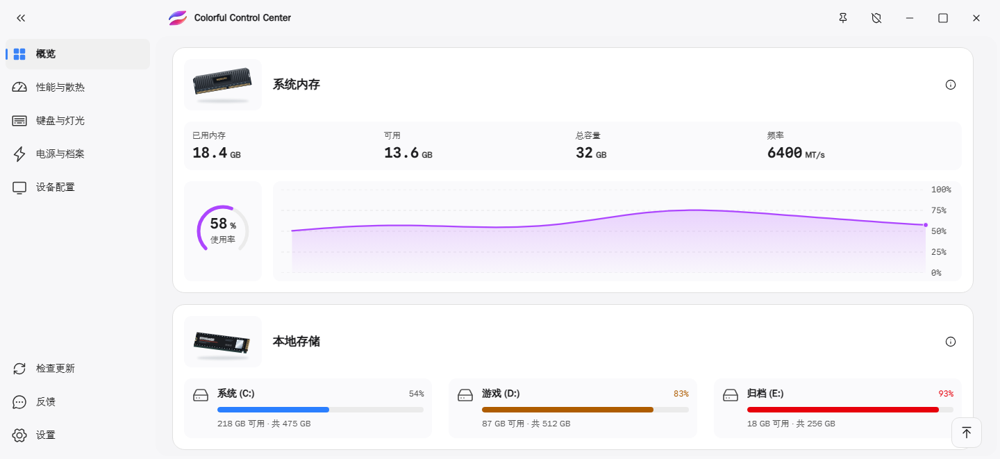
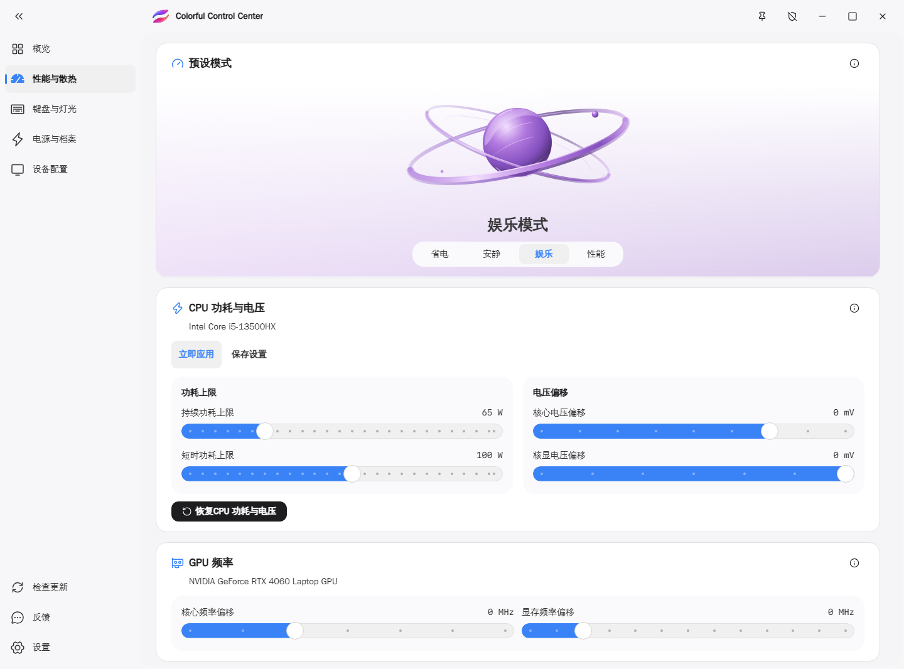
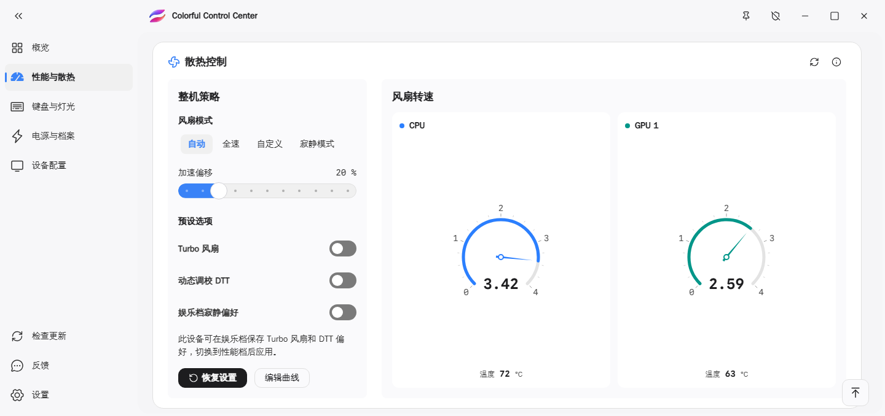
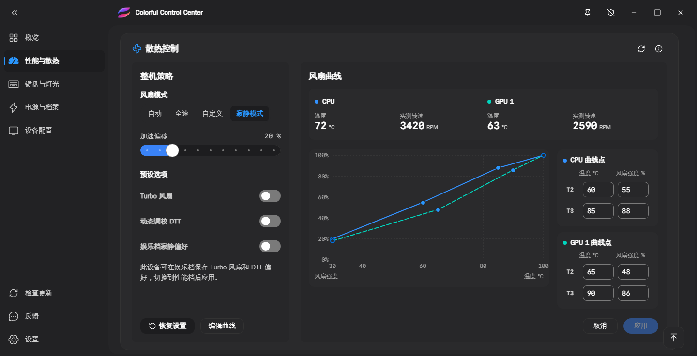
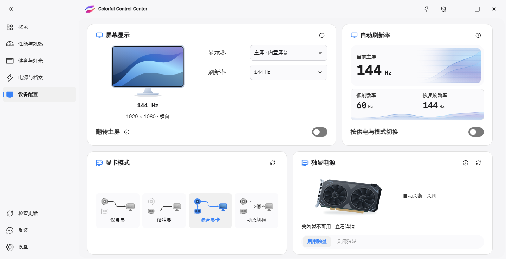
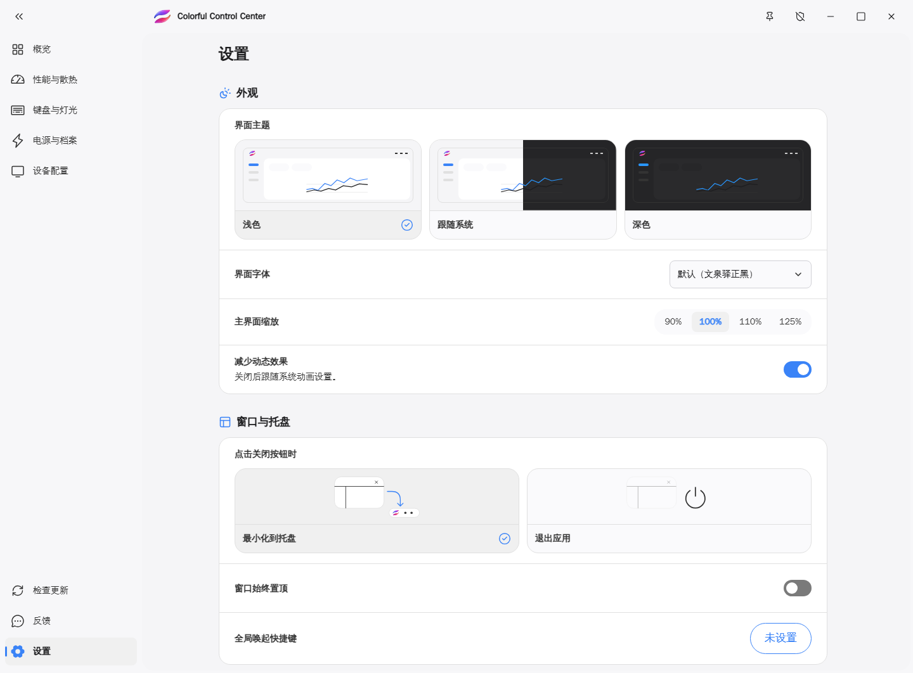
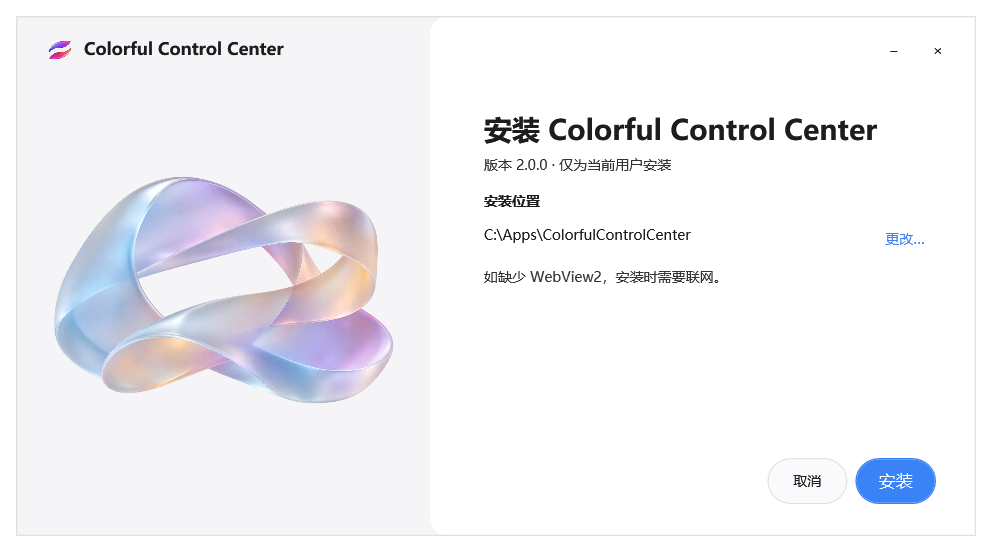

  

<h1 align="center">Colorful Control Center</h1>

七彩虹游戏本的非官方 Windows 控制台

简体中文 · <a href="README.en.md">English</a>

  <a href="https://github.com/y4Nkk/colorful-control-center/releases">下载安装</a> · <a href="CHANGELOG.md#200">2.0.0 发布说明</a> · <a href="docs/development.md">源码构建</a>

## 项目说明

Colorful Control Center 是为七彩虹游戏本开发的开源 Windows x64 硬件控制台。可在同一个窗口查看 CPU、GPU、风扇和内存的实时读数，并调整设备支持的性能、散热、键盘灯光、充电和显示设置。

配置档案内置安静办公、移动续航和插电游戏，应用前可以核对当前值和目标值。还可将常用设置保存为个人档案，用于启动、接通电源、电池供电和唤醒规则。档案和软件偏好保存在本机。

## 下载与安装

1. 在 GitHub Releases 选择所需版本，下载 Windows x64 安装包。2.0.0 的文件名为 `ColorfulControlCenter_2.0.0_x64-setup.exe`，可用同页的 `SHA256SUMS.txt` 核对。 [下载页面](https://github.com/y4Nkk/colorful-control-center/releases)
2. 运行安装向导，为当前 Windows 用户安装。向导需要 .NET Framework 4.8.1，并可在需要时联网准备 WebView2。 [系统要求](https://learn.microsoft.com/dotnet/framework/get-started/system-requirements)
3. 首次打开后，从「概览」确认本机可用的读数，再进入对应工作区。支持应用内更新的版本可从侧栏底部或「设置 → 关于」检查更新并确认下载。

## 设备支持

项目面向采用蓝天或联宝模具的七彩虹游戏本，开发基准机为将星 X15 AT 23（Core i5-13500HX、GeForce RTX 4060 Laptop GPU）。预设档位、风扇曲线、充电保护和显卡切换等功能取决于机型、固件与驱动。原厂功能使用机型对应的 InsydeDCHU 组件和驱动，部分 CPU 实时调校还需要 PawnIO。 [真机验收清单](docs/acceptance-checklist.md)

「设置 → 运行与诊断」可管理原厂软件的退出行为。默认在启动和运行期间关闭已识别的原厂控制中心、Flexikey 和 FnKey，以免同时控制同一硬件设置。

## 功能

| 工作区 | 主要功能 |
| --- | --- |
| **概览** | 当前模式、CPU 和 GPU 温度与利用率、内存趋势、磁盘占用。GPU 和内存的扩展读数从详情查看。 |
| **性能与散热** | 切换固件支持的预设，查看风扇转速，调节风扇模式、加速偏移、曲线、CPU 功耗与电压、GPU 频率。 |
| **键盘与灯光** | 调节分区或逐键 RGB、外围灯区和闲置关灯，管理按键映射、宏及授权接管的原厂热键与屏显。 |
| **电源与档案** | Windows 电源计划、充电范围、节能时段、平台供电及 USB 选择性暂停。创建、导入、导出档案，比较当前值与目标值，并设置自动应用规则。 |
| **设备配置** | 管理刷新率、主屏方向、显卡模式、独显电源、触摸板、麦克风和飞行模式。刷新率和主屏方向提供 15 秒试用。 |
| **设置与托盘** | 管理主题、字体、缩放、动效、窗口和登录自启。从托盘切换受支持的模式、控制风扇或打开档案。 |

## 界面预览

界面截图来自 2.0.0 的生产构建，硬件读数、设备状态和配置档案使用模拟数据。 [截图与数据说明](docs/screenshots/README.md)

### 概览

概览显示当前模式，并排对照 CPU 与 GPU 的温度、频率、风扇强度和利用率。

### 性能与散热

预设模式与 CPU、GPU 调校集中在同一工作区。

各风扇模式默认显示实时转速表盘。在任意档位都可通过「恢复设置」旁的「编辑曲线」调整自定义点位，点击「应用」后配置保存在本地。选择「自定义」时，保存的曲线写入固件。

### 键盘与灯光

键盘预览随灯区颜色、开关与亮度更新。

### 电源与档案

电源设置集中显示 Windows 电源计划、电池状态与充电范围。配置档案可在右侧预览当前设置和应用目标。

### 设备配置

屏幕显示、自动刷新率、显卡模式和独显电源集中在设备配置中。

### 设置

设置分组纵向排列，可调整配色、字体、缩放和窗口行为。

### Windows 安装向导

## 文档

- [开发、构建与隔离验证](docs/development.md)
- [硬件架构与恢复语义](docs/design.md)
- [界面设计与组件契约](DESIGN.md)
- [版本历史](CHANGELOG.md)
- [问题反馈与功能建议](https://github.com/y4Nkk/colorful-control-center/issues/new/choose)

## 许可证

GPL-3.0。[LICENSE](LICENSE)
